

<a href="https://github.com/leukode-labs"></a>


<a href="https://github.com/leukode-labs/maison-stella-releases/releases/latest"></a>




<table>
  <tr>
    <td width="50%"><a href="https://github.com/leukode-labs/System-Commander"></a></td>
    <td width="50%"><a href="https://github.com/leukode-labs/CodiNation"></a></td>
  </tr>
  <tr>
    <td width="50%"><a href="https://github.com/leukode-labs/fluxcast-domains"></a></td>
    <td width="50%"><a href="https://github.com/leukode-labs/ngl-troll"></a></td>
  </tr>
</table>


<a href="https://github.com/leukode-labs"></a>


